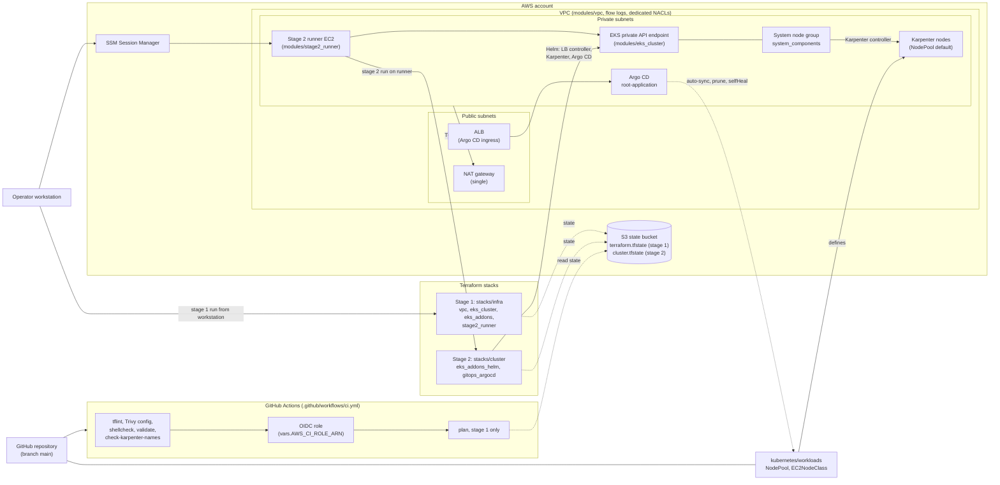

# Enterprise AWS EKS GitOps Platform

[](https://github.com/Adonitologist/aws-eks-gitops-platform/actions/workflows/ci.yml)


A production-grade, declarative Cloud-Native infrastructure engineered by Juan E. This repository establishes a strict GitOps methodology on Amazon Elastic Kubernetes Service (EKS). It separates infrastructure provisioning from application lifecycle management: Terraform handles the foundational AWS layer, while ArgoCD assumes complete control over cluster state using the App of Apps pattern.

## System Architecture & GitOps Flow

1. **Infrastructure as Code (Terraform):** Provisions a dedicated VPC with multi-AZ topology, private subnets with auto-discovery tags, and a managed EKS control plane.
2. **Zero-Trust Identity (AWS IAM & IRSA):** Implements OpenID Connect (OIDC) to map native AWS IAM roles directly to Kubernetes Service Accounts, adhering to the principle of least privilege.
3. **Dynamic Compute (Karpenter):** Replaces traditional Auto Scaling Groups. Karpenter observes unschedulable pods and natively provisions right-sized, cost-optimized EC2 instances (Spot and On-Demand) directly from the AWS API in milliseconds.
4. **Continuous Deployment (ArgoCD):** Installed via Helm during the infrastructure bootstrap, ArgoCD syncs `kubernetes/workloads` from this Git repository once the root application is created (see "Creating root-application" below), continuously reconciling the cluster state against the defined manifests.

## Core Technical Highlights

* **App of Apps Pattern:** The `root-app.yaml` dictates the entire cluster configuration. Any unauthorized manual changes made via `kubectl` are automatically detected and overwritten by ArgoCD to enforce Git as the single source of truth.
* **Remote State Management:** Terraform state is stored remotely in Amazon S3 with native S3 state locking (`use_lockfile`, no DynamoDB), in two separate states (see [ADR 0001](docs/adr/0001-private-eks-endpoint.md)).
* **Automated Quality Gates:** Integrated GitHub Actions pipeline enforces syntax validation, `tflint` standards, and Trivy (`trivy config`) static security analysis on every commit.
* **SSL Offloading Prepared:** ArgoCD is deployed securely in ClusterIP mode without internal TLS, architected to allow the AWS Load Balancer Controller to handle Ingress routing and certificate termination. Without a custom domain (`argocd_hostname` empty) the ingress has no host match: read the ALB DNS name with `kubectl get ingress -n argocd` and open it over HTTP (no TLS listener yet; the ALB only accepts the CIDRs in `argocd_allowed_cidrs`); `argocd-cm` `url` stays `https://`.

## Architecture Diagram

Every box maps to a file in this repository. Solid arrows are runtime access or deployment paths; dotted arrows are reads of Git content or Terraform state.



Notes:

* Stage 1 (`stacks/infra`) is run from the workstation; stage 2 (`stacks/cluster`) is run on the runner because the API endpoint is private ([ADR 0001](docs/adr/0001-private-eks-endpoint.md), [ADR 0002](docs/adr/0002-stage2-access-path.md)).
* CI plans stage 1 only; it never plans or applies stage 2 and has no apply job.
* `kubernetes/argocd-apps/root-app.yaml` is applied by hand once; Argo CD then syncs `kubernetes/workloads` from `main`.

### Cost

Reference table for the live test. The figures are Cost Explorer estimates, not an invoice.

| Run | Duration and scope | Actual cost |
|-----|--------------------|-------------|
| Live test 2026-10-11 | about 1h10m, EKS + NAT + 2 system nodes + runner + up to 2 Karpenter nodes | see day total |
| Live test 2, 2026-10-11 | about 1h50m, apply 19:41 local to destroy end 21:29 local, including fixes; 117 + 4 resources; EKS + NAT + 2 system nodes + runner + 1 live Karpenter node | see day total |

Day total, not per run: Cost Explorer shows about USD 1.02 gross in Usage rows for 2026-10-11 UTC for the whole account, marked Estimated. It cannot be attributed to either live test without cost allocation tags, and Estimated data may still change. Of it, about USD 0.05 are Cost Explorer API calls. Covered 100% by AWS credits, net 0. Gross by service: EC2-Other 0.41, EC2-Compute 0.26, EKS 0.13, VPC 0.13, ELB 0.05. Data Transfer showed only a credit row (-0.038) with no Usage row, unexplained.

Main hourly cost drivers, approximate AWS list prices (us-east-1, on-demand), NOT VERIFIED; check the AWS pricing pages and Billing before relying on them:

| Driver | Approx. hourly price (NOT VERIFIED) |
|--------|-------------------------------------|
| EKS control plane | about USD 0.10 |
| NAT gateway (single) | about USD 0.045, plus per-GB data processing |
| System nodes, m7i-flex.large x 2 | about USD 0.10 each |
| Karpenter nodes, m7i-flex.large or c7i-flex.large (up to 2) | about USD 0.09 to 0.10 each |
| Stage 2 runner, t3.small (only while running) | about USD 0.02 |
| ALB (Argo CD ingress) | about USD 0.02, plus LCU usage |
| Public IPv4 addresses (NAT, ALB) | about USD 0.005 each |

Not itemized: CloudWatch (flow logs, session logs), S3 state storage and data transfer. Use the [Safe Teardown Protocol](#safe-teardown-protocol-cost-prevention) to stop the charges.

## Repository Structure

```text
.
|-- .github/workflows/ci.yml       # Automated security and validation pipeline
|-- modules/
|   |-- vpc/                       # Network topology and discovery tags
|   |-- eks_cluster/               # Control plane, OIDC, and System Node Group
|   |-- eks_addons/                # IAM roles, SQS, Pod Identity (stage 1)
|   |-- stage2_runner/             # SSM-only EC2 that runs stage 2 against the private endpoint (stage 1)
|   |-- eks_addons_helm/           # AWS Load Balancer Controller and Karpenter via Helm (stage 2)
|   `-- gitops_argocd/             # ArgoCD Operator bootstrap via Helm (stage 2)
|-- stacks/
|   |-- infra/                     # Stage 1: vpc, eks_cluster, eks_addons (state: terraform.tfstate)
|   `-- cluster/                   # Stage 2: Helm releases and ArgoCD (state: cluster.tfstate)
|-- kubernetes/
|   |-- argocd-apps/               # Root application controller
|   `-- workloads/                 # Karpenter NodePools and dynamic deployments
`-- docs/adr/                      # Architecture decision records
```

Design decisions: [ADR 0001: private EKS endpoint and two-stage split](docs/adr/0001-private-eks-endpoint.md), [ADR 0002: stage 2 access path](docs/adr/0002-stage2-access-path.md), [ADR 0003: operator credentials](docs/adr/0003-operator-credentials.md).

## Operator credentials
The workstation IAM user has no direct permissions: it can only assume the Terraform operator role (administrator, MFA required, 1 hour session) and the read-only role used by Claude Code. Stage 1 plan, apply and destroy and `scripts/teardown/check-leftovers.ps1` run with the `tf-admin-tf` profile; stage 2 runs on the runner with its instance role.

```powershell
aws sts get-caller-identity --profile tf-admin   # asks for the MFA code, caches a 1 hour session
$env:AWS_PROFILE = 'tf-admin-tf'                  # then run Terraform as usual
```

The session lasts one hour; a Terraform run longer than that is expected to fail (NOT VERIFIED), so repeat the first command and re-run. The profile `readonly` is for read-only plans (`-lock=false`) and Claude Code. Design and verification status: [ADR 0003](docs/adr/0003-operator-credentials.md).

## Deployment Instructions
**Prerequisites**

* AWS CLI with the `tf-admin` and `tf-admin-tf` profiles configured (see Operator credentials).
* Terraform v1.10+ (native S3 locking; CI uses 1.15.6).
* An isolated S3 bucket for remote state, bootstrapped out-of-band to prevent accidental destruction. Its name in `stacks/infra/backend.tf` and `stacks/cluster/backend.tf` must point to it.

**Apply order: infra, then cluster**

The stacks have separate states and must be applied in this order. Stage 2 reads stage-1 outputs and requires the Pod Identity agent addon created by stage 1 (a cross-stack `depends_on` is not possible, so `stacks/cluster` fails its plan if the addon is missing). Stage 2 must run on the stage 2 runner, an SSM-only EC2 instance that stage 1 creates inside the VPC (start it, open a Session Manager shell, run Terraform in tmux, stop it; procedure in [ADR 0002](docs/adr/0002-stage2-access-path.md)). See [ADR 0001](docs/adr/0001-private-eks-endpoint.md) for the known issues to fix before the first apply.

1. Stage 1, AWS resources (VPC, EKS, IAM, SQS, Pod Identity):
   ```bash
   cd stacks/infra
   terraform init
   terraform plan -var="environment=production"
   terraform apply -var="environment=production"
   ```
2. Stage 2, Helm releases and Argo CD, run on the stage 2 runner after cloning this repository there (see ADR 0002):
   ```bash
   cd stacks/cluster
   terraform init
   terraform plan -var='argocd_allowed_cidrs=["203.0.113.10/32"]'
   terraform apply -var='argocd_allowed_cidrs=["203.0.113.10/32"]'
   ```
   `argocd_allowed_cidrs` has no default and restricts the Argo CD ALB (`alb.ingress.kubernetes.io/inbound-cidrs`) to those IPv4 CIDRs; `0.0.0.0/0` is rejected. Replace the documentation-range example with the egress IP of the network you browse from. Never commit the real value: pass it with `-var` (or `TF_VAR_argocd_allowed_cidrs`) typed in the runner session; `*.tfvars` and `*.auto.tfvars` are git-ignored. The runner shell history and the CloudWatch session log will contain it. A wrong or outdated CIDR locks you out of the ALB (not out of `kubectl port-forward`) until stage 2 is applied again with the right value.
3. Create the root application (see Creating root-application below), then verify GitOps synchronization. Argo CD syncs `kubernetes/workloads`:
   ```bash
   aws eks update-kubeconfig --region us-east-1 --name eks-gitops-production
   kubectl get nodepools
   ```

### Creating root-application

Proposed procedure, NOT VERIFIED against the live run. No Terraform resource creates `root-application`, so it is applied by hand after the stage 2 apply, with `kubectl` against the private endpoint (stage 2 runs on the runner; step 2 of Deployment Instructions says to clone this repository there):

```bash
kubectl apply -f kubernetes/argocd-apps/root-app.yaml
kubectl get application root-application -n argocd
```

The manifest syncs `kubernetes/workloads` (the Karpenter EC2NodeClass and NodePool) from the GitHub repository with `targetRevision: main` (`kubernetes/argocd-apps/root-app.yaml:13`), with automated sync, prune and self-heal.

### Post-Deploy Checklist

The API endpoint is private-only, so run these on the stage 2 runner (see ADR 0002).

1. Nodes are Ready: `kubectl get nodes` shows all system nodes in `Ready`.
2. Image pulls work (private subnets reach the internet only on TCP 443 through the NAT): `kubectl get pods -A` shows no `ImagePullBackOff` or `ErrImagePull`.
3. CoreDNS is resolving: `kubectl -n kube-system get pods -l k8s-app=kube-dns` are `Running`, and `kubectl run dns-test --rm -it --restart=Never --image=busybox:1.36 -- nslookup kubernetes.default` returns an answer.
4. Flow logs are flowing: the CloudWatch log group for `vpc-eks-gitops-<environment>` receives events.
5. Network policy enforcement (NOT VERIFIED until the live test): the vpc-cni add-on has `enableNetworkPolicy = true` (`vpc_cni_enable_network_policy`, default true) and `kubernetes/workloads/sample-app/networkpolicy.yaml` denies all traffic in `sample-app` except DNS and same-namespace pods. First check that probes still pass: `kubectl -n argocd get pods` and `kubectl -n sample-app get pods` must show every pod `Running` and ready (expected). If Argo CD pods stay not ready, the fallback is `global.networkPolicy.create = false` in `modules/gitops_argocd/main.tf` (or `vpc_cni_enable_network_policy = false`); see ADR 0001, "Addendum 2026-10-12: network policy".
6. Network policy demonstration (apply from the repo on the runner; `kubernetes/tests/` is not synced by Argo CD):
   ```bash
   kubectl apply -f kubernetes/tests/netpol-test.yaml
   kubectl -n sample-app rollout status deploy/np-allow
   kubectl -n np-test rollout status deploy/np-deny
   kubectl -n sample-app get networkpolicy                # 3 policies: default-deny-all, allow-dns-egress, allow-same-namespace
   kubectl get policyendpoints -A                         # objects created by EKS for the policies
   kubectl -n kube-system get networkpolicy               # expected: none (NOT VERIFIED for the managed CoreDNS add-on)
   kubectl -n sample-app exec deploy/np-allow -- wget -qO- -T 3 http://sample-app.sample-app.svc.cluster.local   # expected: nginx page
   kubectl -n np-test exec deploy/np-deny -- wget -qO- -T 3 http://sample-app.sample-app.svc.cluster.local       # expected: timeout
   kubectl -n sample-app exec deploy/np-allow -- wget -qO- -T 3 http://example.com                               # expected: timeout (egress denied)
   kubectl -n sample-app exec deploy/np-allow -- nslookup sample-app.sample-app.svc.cluster.local                # expected: resolves (DNS allowed)
   ```
   Cleanup: `kubectl delete -f kubernetes/tests/netpol-test.yaml`.

## Safe Teardown Protocol (Cost Prevention)

Destroying a GitOps cluster strictly requires draining dynamic resources prior to invoking Terraform. Failure to do so will result in orphaned EC2 Spot instances and deadlocked VPC dependencies.

Teardown is the reverse of the apply order: cluster stack (stage 2) first, then infra. Steps 1 to 5 need the private endpoint, so start the stage 2 runner and run them there (see ADR 0002). Steps 6 and 7 run from your workstation: step 7 also destroys the runner.

Steps 1 to 3 are automated by `scripts/teardown/teardown-stage2.sh` (run it on the runner; `--dry-run` previews it; set `ARGOCD_ALLOWED_CIDRS` so it prints the step 5 command with your CIDR). It stops with a clear error on any timeout or failed query, and never runs `terraform destroy`. The ALB check needs `tag:GetResources` on the runner role (stage 1 must be applied with that policy). The manual commands below are the fallback. The script was run live on 2026-10-11: in one run the ingress was deleted and no ALB was left after about 31 s; in the run with a live Karpenter node the ALB was gone in about 24 s and deleting the root application took about 35 s, and its cascade removed the NodePool, EC2NodeClass and the node. The script's final Karpenter wait loop passed immediately, so it was not exercised.

1. **Delete the Argo CD ingress and the root application:**
   The Argo CD ALB ingress is created by the Helm release (stage 2), not by Argo CD, so deleting the root application does not remove it. Confirm the ingress name, then delete it so the AWS Load Balancer Controller dismantles its ALB. Then delete the root application, which removes the NodePool and EC2NodeClass it syncs from `kubernetes/workloads`.
   ```bash
   kubectl get ingress -n argocd
   kubectl delete ingress argocd-server -n argocd
   kubectl delete application root-application -n argocd
   ```

2. **Wait for the ALBs to disappear:**
   Do not continue while load balancers created by the controller still exist, or the VPC cannot be deleted.
   ```bash
   aws elbv2 describe-load-balancers --query "LoadBalancers[].LoadBalancerName"
   ```
   The Argo CD ALB can take time to disappear; do not continue until the command returns an empty list.

3. **Drain Karpenter Capacity:**
   Force Karpenter to cordon and terminate all dynamically provisioned EC2 compute nodes to prevent ghost charges.
   ```bash
   kubectl delete nodepool --all
   kubectl delete ec2nodeclass --all
   ```

4. **Purge Orphaned Finalizers (If Namespace Deadlocked):**
   If the argocd namespace hangs in Terminating state, force the release of lingering finalizers:
   ```bash
   kubectl patch application root-application -n argocd --type=merge -p '{"metadata":{"finalizers":[]}}'
   ```

> Note: do not uninstall Argo CD before the ALB ingress, the NodePools, the EC2NodeClasses and the Argo CD Application are deleted. The Application finalizer blocks the namespace otherwise.

5. **Destroy the cluster stack (stage 2):**
   ```bash
   cd stacks/cluster
   terraform destroy -var='argocd_allowed_cidrs=["203.0.113.10/32"]'
   ```

6. **Check for leftovers (gate before stage 1):**
   Run from the workstation with the `readonly` profile, or `tf-admin-tf` after `tf-admin` has cached a session (see Operator credentials). It is read-only (aws describe/list calls) and lists only ids.
   ```powershell
   .\scripts\teardown\check-leftovers.ps1
   ```
   Do not run step 7 on exit 1. A Karpenter node that was removed can leave an orphan ENI (status `available`, no attachment) that blocks deletion of the security groups and the VPC. After confirming the instance is terminated, delete the listed ENI by hand and re-run the check. After step 7, `-AfterDestroy` confirms nothing is left; a remaining `eks-cluster-sg-*` security group is deleted by hand once no ENI uses it. NAT gateways and EC2 instances are not checked (no verified cluster tag).

7. **Destroy the infra stack (stage 1):**
   ```bash
   cd stacks/infra
   terraform destroy
   ```

> PowerShell note: quote the flag, for example `"-out=destroy.tfplan"`. A stale plan must be re-planned and applied immediately.

## License

MIT, see LICENSE.
